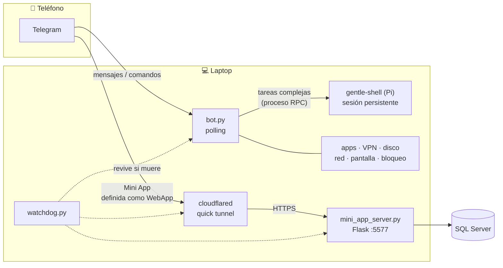

# 🕷️ SpiderVic Assistant — Telegram → Laptop

Asistente personal con dos mitades que se completan:

1. **Bot de Telegram** (`bot.py`) que corre en tu laptop y te deja controlarla a distancia:
   bloqueo, captura de pantalla, gestión de apps, limpieza de disco, VPN FortiGate,
   escaneo de red y una sesión persistente de agente (gentle-shell / Pi) para
   conversar y ejecutar tareas complejas.
2. **Mini App "Ocupabilidad"** (`mini_app/` + `mini_app_server.py`) — una web dentro de
   Telegram para registrar horas en la base SQL Server corporativa, con reportes,
   gráficos y comparativas por analista.

**Dos canales, una laptop:** los *mensajes* del chat pasan por el bot; la *Mini App*
viaja por un túnel Cloudflare hasta el servidor Flask. El watchdog revive todo lo
que se caiga.



> En GitHub este diagrama se dibuja solo (Mermaid nativo). Si lo leés en texto
> plano: Telegram ⇄ bot.py ⇄ gentle-shell para el chat, y Telegram → cloudflared
> → mini_app_server.py → SQL Server para la Mini App, con watchdog.py
> supervisor de los tres servicios de la laptop.

## Estructura del proyecto

```
APP TELEGRAM/
├── bot.py                  # Bot de Telegram: comandos + barra rápida + RPC shell
├── watchdog.py             # Centinela: revive mini_app_server, cloudflared y bot.py
├── mini_app_server.py      # Flask :5577 — API de la Mini App (Ocupabilidad)
├── apps_control.py         # Listar / abrir / cerrar apps de Windows
├── disk_clean.py           # Preview + limpieza de basura en disco
├── forti_vpn.py            # Conecta / desconecta VPN FortiGate (pywinauto)
├── net_scan.py             # Escaneo de red + baseline de dispositivos conocidos
├── quick_actions.py        # Captura de pantalla + barra rápida de acciones
├── mini_app/               # Frontend de la Mini App (HTML + JS, tema nativo Telegram)
├── scripts/
│   ├── kill_all.py           # Mata sesiones RPC y shells vivas
│   ├── restart_bot.py        # Reinicio ordenado: mata bot viejo → kill_all → bot nuevo
│   ├── schedule_restart.ps1  # Restart diferido (deja llegar la última respuesta)
│   └── install_cloudflared.ps1 # Re-descarga cloudflared.exe si falta
├── tests/
│   └── test_v3.py            # Pruebas offline (sin red, sin Telegram)
├── start_spidervic.cmd     # Arranque del bot (tarea programada de Windows)
├── start_watchdog.cmd      # Arranque del watchdog (Startup de Windows)
├── .env.example            # Plantilla de configuración
└── requirements.txt
```

**No se sube a GitHub (`.gitignore`):** `.env` (secretos), `tools/` (binario
cloudflared.exe de 53 MB + logs del túnel, regenerable con
`scripts/install_cloudflared.ps1`), logs, `net_nombres.json` (datos runtime).

## Configuración inicial

1. Cloná el repo y creá tu `.env` a partir de la plantilla:

```powershell
Copy-Item .env.example .env
notepad .env
```

```ini
TELEGRAM_BOT_TOKEN=<token de @BotFather>
ALLOWED_USER_IDS=<tu user ID de Telegram>   # lista separada por comas
SESSION_ID=spidervic-telegram
TIMEOUT_SECONDS=600
MINIAPP_CHAT_ID=<chat ID para el botón de la Mini App y alertas>
```

- ¿No sabés tu user ID? Mandale `/id` al bot: te lo responde aunque no estés en la whitelist.
- Con `ALLOWED_USER_IDS` vacío el bot **no ejecuta nada** — solo responde `/id`.
- Con `MINIAPP_CHAT_ID` vacío, los módulos usan el primer ID de `ALLOWED_USER_IDS` como fallback.

2. Instalá dependencias (una vez):

```powershell
& "$env:LOCALAPPDATA\Microsoft\WindowsApps\python.exe" -m pip install -r requirements.txt
```

3. Regenerá el binario del túnel (si no existe `tools/cloudflared.exe`):

```powershell
powershell -ExecutionPolicy Bypass -File scripts\install_cloudflared.ps1
```

## Arranque

| Qué | Cómo |
|---|---|
| Bot de Telegram | `start_spidervic.cmd` (o `python bot.py`) |
| Watchdog (Mini App + túnel + bot) | `start_watchdog.cmd` — ponerlo en Startup de Windows |
| Mini App sola | `python mini_app_server.py` (escucha :5577) |
| Reinicio ordenado del bot | `python scripts\restart_bot.py` |

El buscador de URL del túnel: cada arranque de cloudflared genera una URL
`*.trycloudflare.com` nueva; el watchdog la detecta en el log, la persiste en
`tools/tunel_url.txt` y re-registra el botón la Mini App en tu chat.

**Dependencia externa:** `mini_app_server.py` importa `llenar_horas_automatico`
desde el proyecto hermano `OCUPABILIDAD AUTOMATIZACION` (path absoluto definido
en el propio archivo). Sin ese proyecto la Mini App no funciona; el bot sí.

## Comandos del bot

### Sesión y control
| Comando | Qué hace |
|---|---|
| `/start`, `/help` | Ayuda + activa la barra rápida de acciones |
| `/estado` | Estado del proceso RPC (viva, durmiendo, cola) |
| `/status` | Tarjeta de estado: CPU, RAM, disco, VPN, RPC |
| `/top` | Procesos con más uso |
| `/reset` | Reinicia la sesión del agente |
| `/compact` | Compacta el contexto de la sesión |
| `/id` | Muestra tu user ID de Telegram |
| `/bloquear` | 🔒 Bloquea la laptop |

### Acciones en la laptop
| Comando | Qué hace |
|---|---|
| `/foto` | 📸 Captura de pantalla y la manda por Telegram |
| `/apps` | Lista de apps instaladas |
| `/forzar_cerrar <proc>` | Fuerza el cierre de un proceso (con confirmación) |
| `/limpiar` | Preview de limpieza de disco (con confirmación) |
| `/vpn` | Estado de la VPN + botones conectar / desconectar |
| `/quienhay` | Escaneo de red: dispositivos conectados vs baseline |
| `/nombra <mac> <nombre>` | Etiqueta un dispositivo conocido |
| `/traer <archivo>` | Busca un archivo (Descargas/Escritorio/Docs) y lo manda |

**Barra rápida:** `Status · Foto · Apps · VPN · Disco · Bloquear` (reply keyboard).

**Seguridad:** whitelist por ID (`ALLOWED_USER_IDS`); confirmación inline para
acciones destructivas (`/limpiar`, `/forzar_cerrar`, apagar); entrada sanitizada
para filtros de PowerShell (`/traer`); modo silencioso nocturno (23:00–07:00).

## Mini App — Ocupabilidad

Endpoints expuestos por `mini_app_server.py` (todos validan `X-Init-Data` HMAC-SHA256
contra `TELEGRAM_BOT_TOKEN` + whitelist `MINIAPP_CHAT_ID`):

| Endpoint | Qué hace |
|---|---|
| `GET /api/estado?fecha` | Estado de registros para una fecha |
| `POST /api/registrar` | Registra horas (`dry_run=true` para preview) |
| `GET /api/reportes?mes&anio` | Estadísticas del mes: analistas, % cumplimiento, evolución, heatmap |

Requisito para que funcione: SQL Server accesible y el proyecto hermano
`OCUPABILIDAD AUTOMATIZACION` con `llenar_horas_automatico` instalado.

## Watchdog — cómo se recupera solo

Cada 5 minutos el watchdog (`watchdog.py`):

1. Chequea `http://127.0.0.1:5577/` → si muere, relanza `mini_app_server.py` oculto.
2. Verifica la URL del túnel → si no responde, mata cloudflared zombis y lo relanza.
3. Si la URL cambió → guarda `tools/tunel_url.txt` y re-registra el botón en Telegram.
4. (El bot se auto-reinicia si el proceso crudo muere, vía `scripts/restart_bot.py`.)

## Desarrollo

```powershell
# Compilar todos los módulos (sanity check)
& "$env:LOCALAPPDATA\Microsoft\WindowsApps\python.exe" -m py_compile bot.py watchdog.py mini_app_server.py apps_control.py disk_clean.py forti_vpn.py net_scan.py quick_actions.py

# Correr las pruebas offline
& "$env:LOCALAPPDATA\Microsoft\WindowsApps\python.exe" tests\test_v3.py

# Syntax check del frontend
node --check mini_app\app.js
```

En `scripts/` hay utilidades de operación (restart, kill, install_cloudflared); en
`tests/`, verificación sin red. El binario de cloudflared **nunca se versiona** —
regenerar con `scripts/install_cloudflared.ps1`.

---

### Notas de seguridad

- El token de Telegram vive **solo** en `.env` (gitignore). Nunca lo commitees ni lo compartas.
- `MINIAPP_CHAT_ID` y `ALLOWED_USER_IDS` restringen quién puede abrir la Mini App y mandarle comandos al bot.
- Si el token se filtra: revocar en @BotFather con `/revoke` y regenerar `.env`.

### Stack

Python 3.14 · pyTelegramBotAPI · psutil · Flask · pymssql · pywinauto ·
Chart.js (CDN) · Cloudflare quick tunnel
